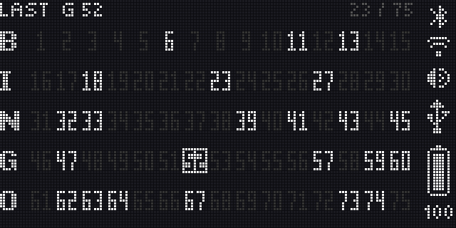

# Bingo

[](https://github.com/jforatier/busy-bar-bingo/actions/workflows/ci.yml) [](LICENSE)

Run a bingo night from your [BUSY Bar](https://busy.app): the drum spins, a voice calls each ball, the host checks cards on the back.

The front display is for the room: the drum spins, the ball rolls out and lands, a voice calls it. The back display is for the host: the board of every number called, to check a winning card at a glance. US 75-ball bingo and 90-ball bingo (the UK game, the French *loto*), in English or French.




> **Status: version 1.0.0, submitted to the BUSY Apps Catalog.** How the app works and why is in [specs/](specs/00-index.md); changes are in [CHANGELOG.md](CHANGELOG.md).

## Playing

| | Manual (default) | Automatic |
|---|---|---|
| **Start** | spins the drum, then stops it: the ball rolls out | plays or pauses the run of draws |
| **OK** | a player calls a win: the host checks the card on the back, OK confirms, Back is a false call | the same, and the run pauses during the check |
| **Wheel** | steps back through the balls already called | the same |
| **OK, held** | starts a new game, after a confirmation | the same |
| **Back** | quits; the game is saved after every ball and comes back when the app opens | the same |

Settings (the bar's settings menu or the BUSY web UI): draw mode and pace, language, voice, sounds, and the traditional nicknames of the numbers (off by default). Players bring their own cards; the app calls the numbers and keeps the board, with no money involved ([specs/13](specs/13-legal.md)).

For a game night, raise the bar's brightness in the BUSY app: an app can't change it.

## Build and install

Requirements: a BUSY Bar connected over USB and **Node 24** (Node 26 is not supported by the BUSY tools). On Windows, use PowerShell or cmd, not Git Bash.

```sh
git clone https://github.com/jforatier/busy-bar-bingo
cd busy-bar-bingo
npm install
npm run build                 # generates sounds, voice, bitmaps and nicknames, then dist/net.foratier.bingo.tgz
npm run app:install && npm run app:run
```

**No BUSY Bar?** The official [BUSY Bar Emulator](https://github.com/busy-app/busybar-emulator) runs the bar's own firmware: start it, then `npx busy-cli app install --addr 127.0.0.1:8640` and `npx busy-cli app run --addr 127.0.0.1:8640`. It has no sound, but every screen is the bar's.

## How it is made

Everything the bar shows or plays is made by this repo: the sounds are synthesized by `scripts/sfx.mjs`, the pixel art is computed by `scripts/pixels.mjs`, both during the build. The bar's JavaScript engine is slow, so the app only picks and moves ready-made bitmaps. The voice clips are generated once by `scripts/voice_gen.py` and committed in `voice/`, because the catalog builds the app offline. The code map, conventions and checks are in [specs/10](specs/10-quality.md).

## Contributing

Bug reports and ideas are welcome as issues. The app is entered in the BUSY Bar Apps Contest, which requires the entry to be the author's own work: pull requests from outside are merged after the results (mid-December 2026). See [CONTRIBUTING.md](CONTRIBUTING.md).

## Credits and licences

The code, sounds, pixel art and nickname lists are under the [MIT licence](LICENSE).

- The voice clips are generated with [Kokoro-82M](https://huggingface.co/hexgrad/Kokoro-82M) by hexgrad (Apache License 2.0), voices `af_heart` (English) and `ff_siwis` (French).
- The French voice was trained on the [SIWIS French Speech Synthesis Database](https://datashare.ed.ac.uk/handle/10283/2353), by Junichi Yamagishi, Pierre-Edouard Honnet, Philip Garner and Alexandros Lazaridis, University of Edinburgh, 2017 ([CC BY 4.0](https://creativecommons.org/licenses/by/4.0/)).
- The package bundles [`@busy-app/busy-lib`](https://www.npmjs.com/package/@busy-app/busy-lib) (Flipper FZCO) and `openapi-fetch`, both MIT; their notices are at the top of `scripts/main.js`.
- BUSY is a trademark of its owner, used here only to name the device the app runs on.

Details: [specs/13](specs/13-legal.md).
